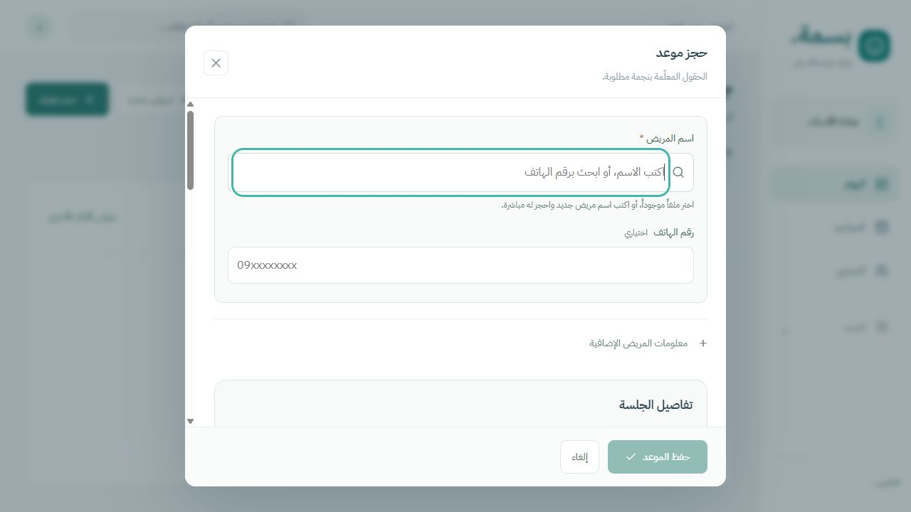
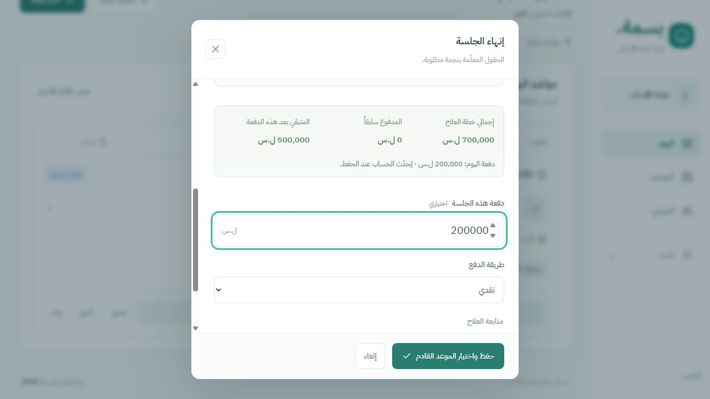

<div align="center">
  
  <h1>Basma Dental Clinic</h1>
  <p>Patient records, appointments, dental charts and payments in an Arabic clinic workspace.</p>
  <p>
    
    
    
    
    
  </p>
  <p><a href="https://basma-dental-clinic.afaq-cloudflare.workers.dev/">Open application</a> · <a href="docs/DEPLOYMENT.md">Deployment</a> · <a href="docs/USER-GUIDE.md">User guide</a> · <a href="docs/TESTING.md">Testing</a></p>
  <p>Developed by <a href="https://github.com/Ahmed-Almohamed"><strong>SY0S</strong></a></p>
</div>

## 🦷 What it does

| Area | Included |
| --- | --- |
| 📅 Appointments | Create a patient and appointment together; suggest existing patients by name or phone; choose a day, available time and multiple treatments with their agreed prices. Reuse existing treatments across visits without charging twice. |
| 👤 Patient records | Contact details, birth date, allergies, medical history, notes, visits, treatment plan, receipts and attachments. |
| 🦷 Dental chart | Interactive permanent and primary teeth using FDI numbering; treatment state per tooth; general sessions without a specific tooth. |
| ⏱️ Daily queue | Reorder pending appointments by drag or accessible move buttons; preserve the booked time. Completed and cancelled visits remain outside the waiting order. |
| 💳 Payments | One patient account with treatment-plan totals, unknown-price alerts, receipts, balance and a live payment preview at session completion. Duplicate completion requests do not duplicate receipts. |
| 📂 Attachments | Authenticated JPG, PNG and PDF uploads/downloads, up to 10 MiB each. |
| 🔎 Search & export | Arabic name and phone search; CSV export of the visible patient search results; JSON export of clinic records. |
| 🔐 Account | Private clinic login, mandatory initial credential change, editable username/password, expiring sessions and login throttling. |

The interface is Arabic and right-to-left. Dates use **Asia/Damascus** and amounts use **Syrian pounds (SYP)**. Fonts are served locally. The application opens persisted clinic records directly.

## 🖼️ Interface





## 🛠️ Stack

- React 19 and TypeScript, with Vinext for routing and server rendering.
- Cloudflare Workers for the application and API.
- Cloudflare D1 for clinic records, accounts, sessions and attachment chunks.
- Drizzle schema definitions and versioned SQL migrations.
- Lucide icons and locally hosted IBM Plex Sans Arabic.

No account credentials, live patient data, database exports or local runtime files belong in this repository. A public source repository does **not** make the clinic records public.

## 🚀 Local setup

Requirements: **Node.js 22.13+**, npm and a Cloudflare account for deployment.

```sh
npm ci
npm run db:migrate:local
node scripts/create-admin.mjs --local
npm run dev
```

Open `http://127.0.0.1:5173`. The account setup command prompts for the username and password without echoing the password. The first sign-in asks the owner to choose their own credentials. Subsequent changes are available from **Settings → Account**.

Local and deployed databases are separate. Local work uses `.wrangler/state`; this directory is ignored by Git. Never use a live database to run the integration tests.

## ☁️ Deployment

See [the deployment guide](docs/DEPLOYMENT.md) for database creation, configuration, migration, account setup, publication and recovery.

```sh
npx wrangler login
npm run db:migrate:remote
node scripts/create-admin.mjs --remote
npm run deploy
```

Create the remote account only once. An existing account is never silently overwritten by the setup command. Updates normally require migrations followed by deployment.

## ✅ Verification

```sh
npm run typecheck
npm run build
node scripts/prepare-tests.mjs
# Keep npm run dev running in another terminal.
npm test
```

Tests use generated local credentials and synthetic local records. They cover authenticated access, patient persistence, session/tooth selection, overlapping bookings, concurrent retries, payment idempotency, queue order, attachment integrity, account changes and session revocation. See [testing notes](docs/TESTING.md) for scope and limitations.

## 🗂️ Project layout

```text
app/                 Arabic UI, account pages and API routes
  api/auth/          Sign-in, sign-out and credential changes
  api/clinic/        Patient, appointment, treatment and receipt operations
  api/files/         Authenticated attachment storage and download
db/                  Database schema and binding access
drizzle/             Ordered database migrations
public/              Icons and local fonts
scripts/             Account setup and local test preparation
tests/               Local integration and regression checks
docs/                Deployment, usage, security and audit notes
worker.ts            Worker entrypoint and response headers
wrangler.jsonc       Cloudflare resource bindings
```

## 📌 Current scope

This is a **single-clinic, single-account** application. It does not provide separate staff roles, prescriptions, insurance processing, automatic reminders or a direct imaging-device connection. Add priced treatments directly while booking, or from the patient's treatment plan. Blank prices remain explicitly unknown; zero means free. Repeat visits reference existing treatments instead of creating new charges. All receipts reduce the patient's overall balance.

Attachments currently share D1 storage with records and use base64 chunks. This is suitable for a small installation; storage grows faster than the original file sizes. Monitor capacity and move attachments to object storage before a large imaging archive accumulates. [Cloudflare D1 limits](https://developers.cloudflare.com/d1/platform/limits/) apply.

## 👨‍💻 Author

**SY0S** · [Ahmed-Almohamed](https://github.com/Ahmed-Almohamed)

Font license: [IBM Plex Sans Arabic — OFL](public/fonts/OFL.txt).

